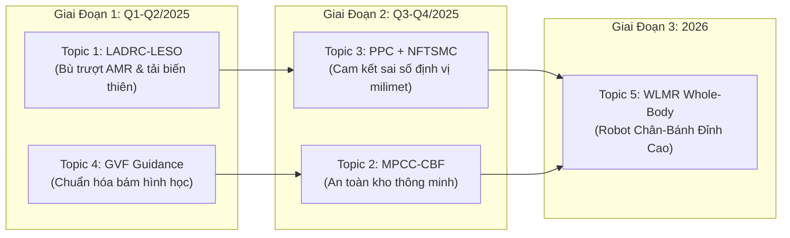

# KẾ HOẠCH NGHIÊN CỨU & CÁC HƯỚNG ĐỀ TÀI KHẢ THI (2024 – 2026)
## Trajectory Tracking Control & Autonomous Robotics Research Roadmap

> **Cơ quan:** Phòng Nghiên cứu Robot & Tự Động Hóa  
> **Tác giả / Chủ nhiệm đề tài:** Nghiên cứu viên / Giảng viên hướng dẫn  
> **Mục tiêu:** Định hình các hướng nghiên cứu mũi nhọn bám quỹ đạo cho mobile robot (AMR, AGV, Mecanum, Wheel-Legged Robot) hướng tới các bài báo khoa học chất lượng cao (ISI Q1/Q2, IEEE T-RO, IEEE T-IE, IEEE T-MECH, Automatica, IEEE RA-L).

---

## MỤC LỤC

1. [Tổng Quan Xu Hướng & Thách Thức Công Nghệ](#1-tổng-quan-xu-hướng--thách-thức-công-nghệ)
2. [Chi Tiết 5 Hướng Nghiên Cứu Khả Thi](#2-chi-tiết-5-hướng-nghiên-cứu-khả-thi)
   - [Topic 1: LADRC-LESO Bù Trượt Bánh và Tải Trọng Biến Thiên](#topic-1-ladrc-leso-bù-trượt-bánh-và-tải-trọng-biến-thiên)
   - [Topic 2: MPCC-CBF Bám Quỹ Đạo An Toàn Ràng Buộc Cao](#topic-2-mpcc-cbf-bám-quỹ-đạo-an-toàn-ràng-buộc-cao)
   - [Topic 3: Prescribed Performance Control (PPC) & Fixed-Time Sliding Mode](#topic-3-prescribed-performance-control-ppc--fixed-time-sliding-mode)
   - [Topic 4: Guidance Vector Field (GVF) Phi Kỳ Dị Toàn Cục](#topic-4-guidance-vector-field-gvf-phi-kỳ-dị-toàn-cục)
   - [Topic 5: Điều Khiển Toàn Thân (WBC) Robot Chân-Bánh (WLMR)](#topic-5-điều-khiển-toàn-thân-wbc-robot-chân-bánh-wlmr)
3. [Ma Trận Đánh Giá Tính Khả Thi & Phân Bổ Nguồn Lực](#3-ma-trận-đánh-giá-tính-khả-thi--phân-bổ-nguồn-lực)
4. [Lộ Trình Triển Khai (Roadmap 2024 – 2026)](#4-lộ-trình-triển-khai-roadmap-2024--2026)
5. [Quy Chuẩn Benchmark & Khung Thử Nghiệm Thực Nghiệm](#5-quy-chuẩn-benchmark--khung-thử-nghiệm-thực-nghiệm)
6. [Mẫu Khởi Động Session Mới (Session Launch Protocol)](#6-mẫu-khởi-động-session-mới-session-launch-protocol)

---

## 1. TỔNG QUAN XU HƯỚNG & THÁCH THỨC CÔNG NGHỆ

Trong giai đoạn 2023–2026, các bài toán bám quỹ đạo cho mobile robot đã vượt qua giới hạn của mô hình hình học cổ điển (như Pure Pursuit đơn thuần hay Kinematic Stanley/Kanayama). Các thách thức mở bao gồm:

```
                            CÁC THÁCH THỨC NGHIÊN CỨU
                                       │
        ┌──────────────────────────────┼──────────────────────────────┐
        ▼                              ▼                              ▼
 [Trượt Bánh & Ma Sát]       [Đảm Bảo An Toàn Tuyệt Đối]    [Động Lực Học Biến Thiên]
 - Wheel slip / skid         - Hard Safety Constraints       - Tải trọng bốc dỡ thay đổi
 - Sàn trơn, dốc nghiêng     - Control Barrier Functions     - Robot chân bánh (WLMR) thay
 - Mòn lốp, trượt vi sai     - Tránh vật cản động thời gian    đổi trọng tâm và chiều cao
                               thực trong kho hẹp
```

---

## 2. CHI TIẾT 5 HƯỚNG NGHIÊN CỨU KHẢ THI

---

### TOPIC 1: LADRC-LESO Bù Trượt Bánh và Tải Trọng Biến Thiên

* **Mã đề tài:** `TRACK-LADRC`
* **Mục tiêu khoa học:** Thiết kế bộ điều khiển kháng nhiễu chủ động tuyến tính (Linear Active Disturbance Rejection Control - LADRC) kết hợp bộ quan sát trạng thái mở rộng (Linear Extended State Observer - LESO) nhằm triệt tiêu hoàn toàn ảnh hưởng của hiện tượng trượt bánh vi sai và tải trọng hàng hóa thay đổi đột ngột mà **không cần nhận dạng ma trận khối lượng hay hệ số ma sát lốp**.
* **Mô hình toán:**
  Phương trình động lực học kênh vận tốc góc $\omega$ và vận tốc dài $v$:
  $$\dot{v} = f_v(v, \omega, t) + b_v u_v$$
  $$\dot{\omega} = f_\omega(v, \omega, t) + b_\omega u_\omega$$
  Trong đó $f_v, f_\omega$ là "tổng nhiễu" (total disturbance) bao gồm trượt lết bánh xe, ma sát sàn không đồng nhất, độ dốc và quán tính xoay không chắc chắn.
  
  Bộ quan sát LESO bậc 3 ước lượng thời gian thực:
  $$\begin{cases}
  \dot{\hat{z}}_1 = \hat{z}_2 + \beta_1 (v - \hat{z}_1) \\
  \dot{\hat{z}}_2 = \hat{z}_3 + b_v u_v + \beta_2 (v - \hat{z}_1) \\
  \dot{\hat{z}}_3 = \beta_3 (v - \hat{z}_1)
  \end{cases}$$
  Với $\hat{z}_3 \to f_v$. Tín hiệu điều khiển bù trực tiếp:
  $$u_v = \frac{u_0 - \hat{z}_3}{b_v}$$
* **Điểm mới (Novelty):**
  - Chỉnh định thông qua khái niệm băng thông (Bandwidth Parameterization) theo Gao: chỉ cần chọn băng thông bộ quan sát $\omega_o$ và băng thông điều khiển $\omega_c$.
  - Tích hợp bù trượt bánh (Slip Angle Estimation) trực tiếp qua FOC motor current feedback mà không cần cảm biến quang đắt tiền.
* **Mục tiêu công bố:** *IEEE Transactions on Industrial Electronics* hoặc *IEEE Transactions on Mechatronics*.

---

### TOPIC 2: MPCC-CBF Bám Quỹ Đạo An Toàn Ràng Buộc Cao

* **Mã đề tài:** `TRACK-MPCC-CBF`
* **Mục tiêu khoa học:** Giải quyết bài toán bám quỹ đạo tốc độ cao trong môi trường kho hẹp có vật cản động bằng phương pháp Model Predictive Contouring Control (MPCC) kết hợp ràng buộc an toàn toán học Control Barrier Functions (CBF).
* **Mô hình toán:**
  Tách sai số thành sai số trực giao $e^c$ (Contouring error) và sai số dọc $e^l$ (Lag error):
  $$\min_{u} \int_{0}^{T} \left( w_c (e^c)^2 + w_l (e^l)^2 - w_\theta \dot{\theta} + u^T R u \right) dt$$
  Ràng buộc an toàn với mọi chướng ngại vật $j$:
  $$h_j(x) = \|p - p_{obs, j}\|^2 - (R_{robot} + R_{obs} + d_{safe})^2 \ge 0$$
  $$\dot{h}_j(x, u) + \gamma h_j(x) \ge 0$$
* **Điểm mới (Novelty):**
  - Khắc phục nhược điểm "cut-corner" của MPC thông thường bằng hàm phạt contouring độc lập với tiến độ thời gian.
  - Tối ưu hóa QP thời gian thực giải bằng PANOC / OSQP ở tần số $50 - 100\,\text{Hz}$ trên máy tính nhúng ARM/Jetson.
* **Mục tiêu công bố:** *Automatica* hoặc *IEEE Transactions on Robotics*.

---

### TOPIC 3: Prescribed Performance Control (PPC) & Fixed-Time Sliding Mode

* **Mã đề tài:** `TRACK-PPC-FTSMC`
* **Mục tiêu khoa học:** Cam kết chất lượng động học quá độ (Transient Response) của sai số bám quỹ đạo: độ vọt lố và sai số xác lập bị khống chế tuyệt đối trong một phễu hàm toán học $\rho(t)$, đồng thời thời gian hội tụ được giới hạn cố định (Fixed-Time) độc lập với vị trí ban đầu của xe.
* **Mô hình toán:**
  Phễu hiệu năng định trước:
  $$-\underline{\delta} \rho_i(t) < e_i(t) < \bar{\delta} \rho_i(t), \quad \forall t \ge 0$$
  Biến đổi không gian sai số qua hàm truyền đơn điệu:
  $$\varepsilon_i(t) = \ln\left( \frac{\underline{\delta} + \frac{e_i(t)}{\rho_i(t)}}{\bar{\delta} - \frac{e_i(t)}{\rho_i(t)}} \right)$$
  Mặt trượt Non-singular Fast Terminal Sliding Mode:
  $$s = \varepsilon + \alpha \varepsilon^{p/q} + \beta \dot{\varepsilon}^{m/n}$$
  Luật điều khiển Super-Twisting liên tục triệt tiêu hiện tượng rung giật chattering.
* **Điểm mới (Novelty):**
  - Ứng dụng xuất sắc cho các hệ thống yêu cầu độ chính xác định vị milimet (AGV cập cảng sạc không dây, nâng hạ pallet tự động).
* **Mục tiêu công bố:** *IEEE Transactions on Automatic Control* hoặc *Control Engineering Practice*.

---

### TOPIC 4: Guidance Vector Field (GVF) Phi Kỳ Dị Toàn Cục

* **Mã đề tài:** `TRACK-GVF`
* **Mục tiêu khoa học:** Xây dựng trường vector giải tích mịn trong không gian $SE(2)$ cho phép robot tiếp cận và bám sát đường cong tham chiếu từ **mọi góc hướng và vị trí bất kỳ** mà không gặp điểm kỳ dị toán học (khắc phục triệt để lỗi góc quay ngược $\pm 180^\circ$ của Pure Pursuit).
* **Mô hình toán:**
  Đường cong mục tiêu biểu diễn dưới dạng tập mức không (zero-level set): $\Gamma = \{p \in \mathbb{R}^2 \mid \phi(p) = 0\}$.
  Trường vector dẫn hướng $\chi(p)$:
  $$\chi(p) = \tau(p) - k_n \nabla \phi(p)$$
  Trong đó $\tau(p)$ là vector tiếp tuyến với đường cong, $\nabla \phi(p)$ là vector pháp tuyến hướng về đường cong, $k_n > 0$ là hệ số hội tụ.
  Góc hướng mong muốn:
  $$\theta_d(p) = \text{atan2}(\chi_y(p), \chi_x(p))$$
* **Điểm mới (Novelty):**
  - Chứng minh tính ổn định tiệm cận toàn cục bằng Contraction Theory.
  - Tích hợp cơ chế thích nghi trực tuyến bù góc trượt sườn (sideslip angle) khi xe chạy trên mặt phẳng nghiêng.
* **Mục tiêu công bố:** *IEEE Transactions on Control Systems Technology* hoặc *IEEE RA-L*.

---

### TOPIC 5: Điều Khiển Toàn Thân (WBC) Robot Chân-Bánh (WLMR)

* **Mã đề tài:** `TRACK-WLMR-WBC`
* **Mục tiêu khoa học:** Điều khiển phối hợp đồng thời (Co-design) giữa bài toán **giữ cân bằng con lắc ngược phi tuyến** và bài toán **bám quỹ đạo phẳng 2D** cho robot di động chân bánh (Wheel-Legged Mobile Robot) có chiều cao chân thay đổi linh hoạt.
* **Mô hình toán:**
  Hệ phương trình Euler-Lagrange liên kết toàn thân:
  $$M(q)\ddot{q} + C(q, \dot{q})\dot{q} + G(q) = S^T \tau + J_c^T \lambda$$
  Trong đó $q = [x, y, z, \psi, \theta_{pitch}, \phi_{roll}, \theta_{L1}, \theta_{L2}, \theta_{R1}, \theta_{R2}, \theta_{wL}, \theta_{wR}]^T$.
  Phân tầng nhiệm vụ bằng Hierarchical Quadratic Programming (HQP):
  - **Task 1 (Ưu tiên cao nhất):** Cân bằng góc nghiêng thân xe $|\theta_{pitch}| \le 5^\circ$ và giới hạn phản lực mặt đất (friction cone constraint $\lambda_z \ge 0, |\lambda_x| \le \mu \lambda_z$).
  - **Task 2:** Điều chỉnh chiều cao trọng tâm $z_{COM}$ để chui qua gầm kệ hàng hoặc vượt bậc thang.
  - **Task 3:** Bám vận tốc dài $v_d$ và vận tốc góc $\omega_d$ theo quỹ đạo logistics.
* **Điểm mới (Novelty):**
  - Tận dụng bậc tự do khớp gối (active suspension) để dịch chuyển trọng tâm chủ động, tăng giới hạn lật xe khi vào cua gấp ở vận tốc cao.
* **Mục tiêu công bố:** *IEEE Transactions on Robotics (T-RO)* hoặc *IEEE/ASME Transactions on Mechatronics*.

---

## 3. MA TRẬN ĐÁNH GIÁ TÍNH KHẢ THI & PHÂN BỔ NGUỒN LỰC

| Đề Tài | Độ Khó Thuật Toán | Yêu Cầu Tính Toán | Mức Độ Khả Thi Trên Web/Lab | Thời Gian Dự Kiến | Tạp Chí Mục Tiêu |
| :--- | :---: | :---: | :---: | :---: | :---: |
| **Topic 1: LADRC-LESO** | Trung bình | Rất nhẹ ($\mathcal{O}(n)$) | **Rất cao (95%)** | 2 - 3 tháng | IEEE T-IE / T-MECH (Q1) |
| **Topic 4: GVF Phi Kỳ Dị** | Trung bình | Nhẹ ($\mathcal{O}(1)$) | **Rất cao (90%)** | 2 - 3 tháng | IEEE TCST / RA-L (Q1/Q2) |
| **Topic 3: PPC & NFTSMC** | Cao | Trung bình | **Cao (80%)** | 3 - 4 tháng | Automatica / CEP (Q1) |
| **Topic 2: MPCC-CBF** | Rất cao | Nặng (Cần QP Solver) | **Khá (70%)** | 4 - 6 tháng | Automatica / T-RO (Q1) |
| **Topic 5: WLMR Whole-Body** | Cực cao | Rất nặng (HQP / MPC) | **Khá (65%)** | 6 - 8 tháng | IEEE T-RO / T-MECH (Q1) |

---

## 4. LỘ TRÌNH TRIỂN KHAI (ROADMAP 2024 – 2026)



---

## 5. QUY CHUẨN BENCHMARK & KHUNG THỬ NGHIỆM THỰC NGHIỆM

Mỗi bài báo khoa học khi triển khai cần tuân thủ bảng chỉ số định lượng bắt buộc sau:

1. **Sai số bám quỹ đạo:**
   - $\text{RMSE}_{xy} = \sqrt{\frac{1}{N} \sum_{k=1}^N (x_k - x_{d,k})^2 + (y_k - y_{d,k})^2}$
   - Sai số vuông góc tối đa: $e_{c,\max} = \max_k |e_k^c|$
   - Sai số góc hướng xác lập: $|e_{\theta, \text{steady}}| \le 0.02\,\text{rad}$ ($~1.1^\circ$).
2. **Tiêu thụ năng lượng & Độ mượt bộ điều khiển:**
   - Năng lượng điều khiển: $E_u = \int_{0}^{T} (u_L^2 + u_R^2) dt$
   - Độ giật điều khiển (Total Variation / Chattering metric): $\text{TV}(u) = \sum_{k=1}^N |u_{k} - u_{k-1}|$
3. **Hiệu năng tính toán thời gian thực:**
   - Thời gian tính toán trung bình mỗi bước: $t_{calc} \le 5.0\,\text{ms}$ (cho vòng lặp $200\,\text{Hz}$).

---

## 6. MẪU KHỞI ĐỘNG SESSION MỚI (SESSION LAUNCH PROTOCOL)

Khi bắt đầu nghiên cứu bất kỳ topic nào ở một session Antigravity mới, hãy dán prompt mẫu sau:

```markdown
Bạn là Chuyên gia Nghiên cứu Điều khiển Robot (Robotics Research Scientist & Senior Control Engineer). 
Tôi muốn bắt đầu triển khai nghiên cứu chuyên sâu về Topic: [TÊN TOPIC, ví dụ: Topic 1 - LADRC-LESO Bù Trượt Bánh].

Ngữ cảnh tham chiếu:
- Thư mục dự án: research/topics/[TÊN_FILE.md]
- Mục tiêu đầu ra: Thiết kế mô hình toán học giải tích, viết code mô phỏng TypeScript/Python, đánh giá sai số RMSE và hoàn thiện bài báo khoa học chuẩn IEEE.

Hãy bắt đầu bằng việc tóm tắt hệ phương trình động lực học và các bước thực hiện Phase 1.
```
